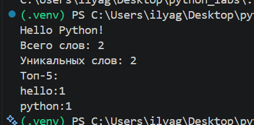
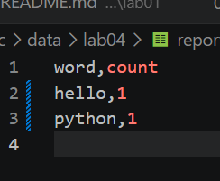
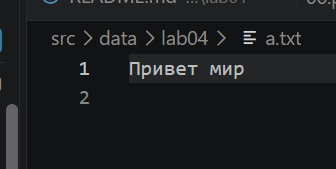
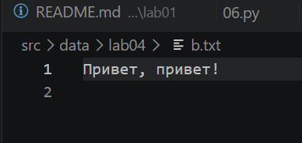
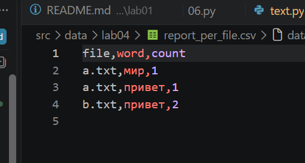
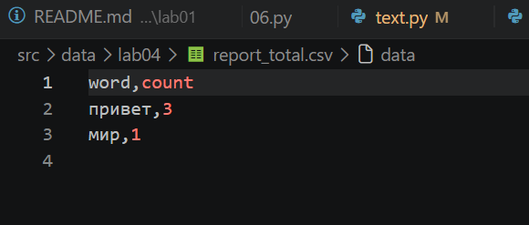
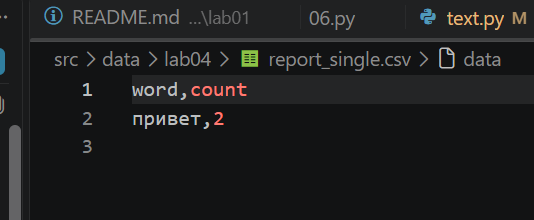
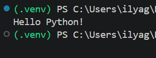
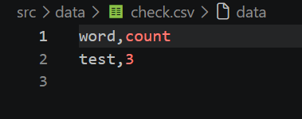

# Лабораторная работа №4 — работа с TXT и CSV

Цель работы — читать текстовые файлы с заданной кодировкой, считать частоты слов и сохранять результаты в CSV. Для нормализации и токенизации используется модуль `src/lib/text.py` из ЛР3.

## Структура

```text
python_labs/
├── images/
│   └── lab04/
│       ├── img01.png
│       ├── img02.png
│       ├── img03.png
│       ├── img04.png
│       ├── img05.png
│       ├── img06.png
│       ├── img07.png
│       ├── img08.png
│       └── img09.png
└── src/
    ├── lab04/
    │   ├── io_txt_csv.py
    │   ├── text_report.py
    │   └── README.md
    ├── lib/
    │   └── text.py
    └── data/lab04/
        ├── input.txt
        └── report.csv
```

## Задание A — `io_txt_csv.py`

В модуле реализованы:

- `read_text(path, encoding="utf-8")` — читает содержимое файла целиком. Для другой кодировки её можно передать явно, например `encoding="cp1251"`. Ошибки отсутствующего файла и неверной кодировки не перехватываются.
- `write_csv(rows, path, header=None)` — записывает строки CSV с разделителем-запятой и кодировкой UTF-8. Если задан `header`, он записывается первой строкой. Проверяется одинаковая длина строк данных и её соответствие заголовку. Выходные папки создаются автоматически.
- `ensure_parent_dir(path)` — создаёт родительские папки, если их нет; вызывается из `write_csv()`.

При пустом `rows` файл создаётся; с заголовком в нём будет только заголовок, без заголовка он будет пустым.

## Задание B — `text_report.py`

Скрипт читает входной файл, нормализует текст, считает частоты слов, печатает статистику и записывает CSV `word,count`. Строки отчёта сортируются по частоте по убыванию, а при равенстве — по слову по алфавиту.

По умолчанию используются пути `src/data/lab04/input.txt` и `src/data/lab04/report.csv`. Команды запуска выполняются из корня проекта.

### Пример запуска

```powershell
python -m src.lab04.text_report
```

Можно указать входной и выходной файлы:

```powershell
python -m src.lab04.text_report --in src/data/lab04/input.txt --out src/data/lab04/report.csv
```

Для входного файла в кодировке Windows-1251:

```powershell
python -m src.lab04.text_report --in src/data/lab04/input.txt --encoding cp1251
```

Пример содержимого входного файла:

```text
Привет, мир! Привет!!!
```

Ожидаемый отчёт `report.csv`:

```csv
word,count
привет,2
мир,1
```

В консоли печатаются общее количество слов, число уникальных слов и топ-5. Если файл не найден, недоступен или его не удалось прочитать в выбранной кодировке, скрипт выводит сообщение в `stderr` и завершается с кодом `1`.

Если входной файл пуст, содержит только пробелы или в нём нет слов, CSV содержит только строку `word,count`, а в консоли выводятся нулевые значения и пустой топ-5.

Пример фактического запуска с текстом `Hello Python!`:



Созданный файл `report.csv`:



## Несколько файлов ★

Дополнительный режим записывает частоты каждого файла отдельно в `file,word,count`, а также суммарные частоты в `word,count`. В качестве значения `file` используется имя файла без родительского пути.

```powershell
python -m src.lab04.text_report --in src/data/lab04/a.txt src/data/lab04/b.txt --per-file src/data/lab04/report_per_file.csv --total src/data/lab04/report_total.csv
```

`report_per_file.csv` сортируется по имени файла, затем по частоте по убыванию и слову по алфавиту. `report_total.csv` сортируется по частоте по убыванию и слову по алфавиту.

Входные файлы для проверки:





Результат ★ — частоты отдельно по каждому файлу:



Общий результат ★:



Для сравнения отдельно запускался обычный режим только для `b.txt`; его результат сохранён в `report_single.csv`:



## Проверка функций ввода-вывода

```python
from src.lab04.io_txt_csv import read_text, write_csv

text = read_text("src/data/lab04/input.txt")
write_csv([("test", 3)], "src/data/check.csv", ("word", "count"))
```

Ручной запуск проверки:



Созданный файл `check.csv`:



## Вывод

Реализованы чтение текстовых файлов в выбранной кодировке, запись CSV и генерация базового и сводных отчётов по частоте слов.
