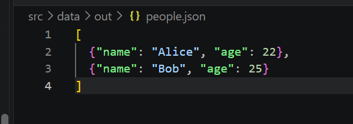
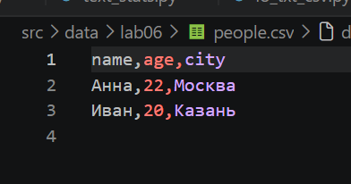

# Лабораторная работа №5 — JSON и конвертации

Цель работы — научиться читать и записывать JSON, преобразовывать данные между JSON и CSV, а также сохранять CSV в формате XLSX.

## Зависимость

Для создания XLSX используется `openpyxl`. Установить его можно из корня проекта:

```powershell
python -m pip install openpyxl
```

Модули `json` и `csv` входят в стандартную библиотеку Python.

## Структура

```text
src/lab05/
├── json_csv.py       # JSON ↔ CSV
├── csv_xlsx.py       # CSV → XLSX
└── README.md

src/data/lab05/
├── people.json
├── people.csv
└── out/              # создаётся при сохранении результатов
```

Пути в примерах считаются от корня проекта. Перед запуском положите входные файлы в `src/data/lab05/`.

## Задание A — JSON ↔ CSV

В `json_csv.py` реализованы две функции:

- `json_to_csv(json_path, csv_path)` — читает непустой JSON-массив словарей и сохраняет его в CSV. Столбцы собираются по ключам в порядке первого появления; если ключ отсутствует в записи, ячейка остаётся пустой.
- `csv_to_json(csv_path, json_path)` — читает CSV с заголовком и сохраняет строки как список словарей в JSON. Значения остаются строками.

Пример `people.json`:

```json
[
  {"name": "Alice", "age": 22},
  {"name": "Bob", "age": 25}
]
```

Пример JSON-файла:



Запуск JSON → CSV из корня проекта:

```powershell
python -c "from src.lab05.json_csv import json_to_csv; json_to_csv('src/data/lab05/people.json', 'src/data/lab05/out/people_from_json.csv')"
```

Получится CSV с заголовком `name,city,age`; отсутствующие значения будут пустыми.

Запуск CSV → JSON:

```powershell
python -c "from src.lab05.json_csv import csv_to_json; csv_to_json('src/data/lab05/people.csv', 'src/data/lab05/out/people_from_csv.json')"
```

Пример входного `people.csv`:

```csv
name,age,city
Анна,22,Москва
Иван,20,Казань
```

Пример CSV-файла:



## Задание B — CSV → XLSX

В `csv_xlsx.py` функция `csv_to_xlsx(csv_path, xlsx_path)` переносит строки CSV в книгу Excel. Первая строка используется как заголовок, лист называется `Sheet1`, ширина каждого столбца подстраивается по содержимому и не бывает меньше 8 символов.

```powershell
python -c "from src.lab05.csv_xlsx import csv_to_xlsx; csv_to_xlsx('src/data/lab05/people.csv', 'src/data/lab05/out/people.xlsx')"
```

Откройте `src/data/lab05/out/people.xlsx` в Excel или LibreOffice и проверьте заголовки, данные и ширину столбцов.

Результат — лист `Sheet1` с данными из CSV:


## Проверка ошибок и допущения

- Для JSON ожидается непустой список словарей; другие структуры приводят к `ValueError`.
- Для CSV требуется непустой заголовок с непустыми уникальными именами столбцов.
- Ожидаются расширения `.json`, `.csv` и `.xlsx` соответственно; неправильное расширение приводит к `ValueError`.
- Если исходный файл не найден, Python сообщает `FileNotFoundError`.
- Файлы читаются и записываются в UTF-8. Для CSV используется стандартный разделитель — запятая.
- Родительские папки выходных файлов создаются автоматически.

## Вывод

Реализованы преобразования JSON → CSV, CSV → JSON и CSV → XLSX. JSON сохраняет структуру списка словарей, CSV представляет её в виде таблицы, а XLSX позволяет открыть эту таблицу в табличном редакторе.
