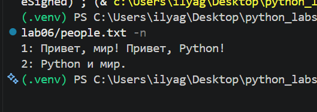
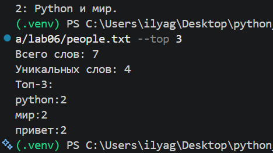
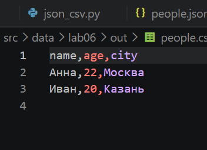
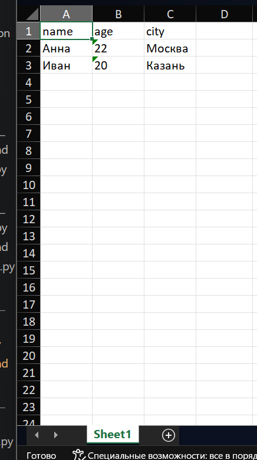

# Лабораторная работа №6 — CLI-утилиты с argparse

Цель работы — запускать функции проекта из командной строки, используя аргументы, флаги и подкоманды.

## Структура

```text
src/lab06/
├── cli_text.py       # cat и статистика текста
├── cli_convert.py    # JSON/CSV/XLSX-конвертеры
└── README.md

src/data/lab06/
├── people.txt
├── people.json
├── people.csv
└── out/              # результаты конвертаций
```

Команды запускаются из корня проекта. Пути к данным указываются относительно него.

## CLI для текста — `cli_text.py`

Посмотреть общую справку:

```powershell
python -m src.lab06.cli_text --help
```

`cat` выводит содержимое файла построчно; флаг `-n` добавляет номера строк:

```powershell
python -m src.lab06.cli_text cat --input src/data/lab06/people.txt -n
```

Ожидаемый вывод:

```text
1: Привет, мир! Привет, Python!
2: Python и мир.
```

Скриншот запуска `cat` с нумерацией:



`stats` считает общее количество слов, число уникальных слов и выводит топ частот. По умолчанию показываются 5 слов; число можно изменить через `--top`.

```powershell
python -m src.lab06.cli_text stats --input src/data/lab06/people.txt --top 3
```

Ожидаемый вывод:

```text
Всего слов: 7
Уникальных слов: 4
Топ-3:
python:2
мир:2
привет:2
```

Скриншот запуска `stats --top 3`:



Подсчёт использует `normalize`, `tokenize`, `count_freq` и `top_n` из `src/lib/text.py`.

## CLI-конвертеры — `cli_convert.py`

Общая справка:

```powershell
python -m src.lab06.cli_convert --help
```

У каждой команды есть обязательные параметры `--in` и `--out`:

```powershell
python -m src.lab06.cli_convert json2csv --in src/data/lab06/people.json --out src/data/lab06/out/people.csv
python -m src.lab06.cli_convert csv2json --in src/data/lab06/people.csv --out src/data/lab06/out/people.json
python -m src.lab06.cli_convert csv2xlsx --in src/data/lab06/people.csv --out src/data/lab06/out/people.xlsx
```

Результаты сохраняются в `src/data/lab06/out/`. JSON↔CSV вызывает функции из ЛР5; CSV→XLSX использует `csv_to_xlsx` из ЛР5.

Пример созданного CSV после конвертации:



Результат команды `csv2xlsx`, открытый в табличном редакторе:



Для XLSX необходим `openpyxl`. Установить зависимости можно из корня проекта:

```powershell
python -m pip install -r requirements.txt
```

## Обработка ошибок

- Если входной файл отсутствует или недоступен, программа печатает понятное сообщение в `stderr` и возвращает код завершения `1`.
- Неверные аргументы и отсутствующая подкоманда обрабатываются `argparse`; справка доступна с `--help`.
- Для `stats` значение `--top` должно быть больше нуля.
- Пустой текст обрабатывается без ошибки: выводятся нулевые количества.

## Вывод

Созданы CLI-команды для вывода и анализа текста и для трёх конвертаций. Аргументы разбираются стандартным модулем `argparse`; логика преобразований переиспользует функции ЛР3 и ЛР5.
