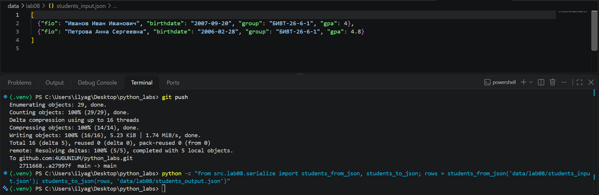
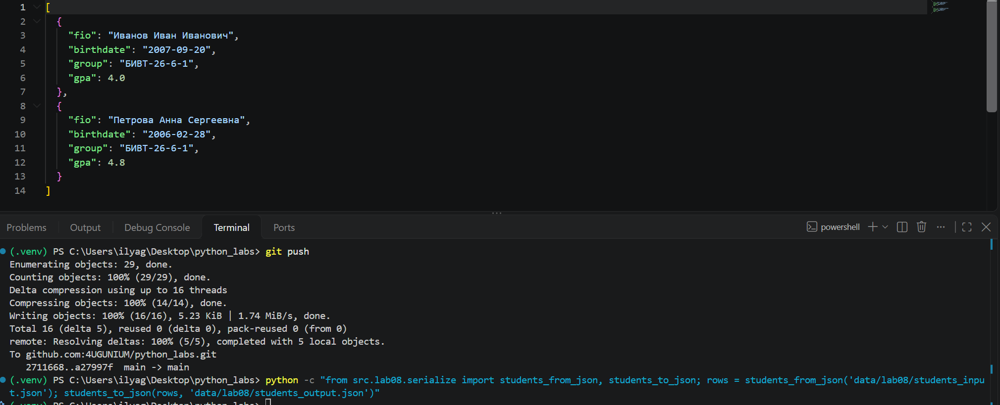
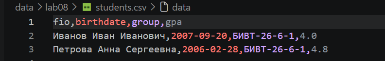

# Лабораторная работа №8 — запись Student

Модель реализована словарём, без классов. Поля: `fio` — непустое ФИО, `birthdate` — существующая дата YYYY-MM-DD не в будущем, `group` — непустая группа, `gpa` — число от 0 до 5. Значения bool и NaN не принимаются.

## Функции

| Функция | Назначение |
|---|---|
| make_student | Проверяет поля, убирает пробелы по краям ФИО и группы, приводит числовой GPA к float |
| validate_student | Проверяет значения и точное совпадение ключей с STUDENT_FIELDS |
| student_age | Считает полные годы с учётом дня рождения; today — объект date |
| format_student | Выводит фамилию, инициалы, группу, возраст и GPA с двумя знаками |
| student_to_dict | Возвращает независимую копию проверенной записи |
| student_from_dict | Проверяет словарь и создаёт новую запись с GPA типа float |
| students_to_json | Проверяет список, сохраняет UTF-8 JSON с ensure_ascii=False и indent=2 |
| students_from_json | Читает массив JSON и проверяет каждую запись |
| update_student ★ | Возвращает новую запись с изменёнными полями; неизвестное поле вызывает KeyError |
| students_from_csv ★ | Читает CSV через DictReader и преобразует GPA в float |

Политика загрузки — **strict**: первая битая запись вызывает ValueError с её номером (начиная с 1) и причиной. Пропущенные и лишние ключи запрещены. Числовые строки GPA не принимаются. Отсутствующий файл вызывает FileNotFoundError, неверный JSON — JSONDecodeError.

## Запуск

Из корня проекта:

```powershell
python -c "from src.lab08.serialize import students_from_json, students_to_json; rows = students_from_json('data/lab08/students_input.json'); students_to_json(rows, 'data/lab08/students_output.json')"
```

Пример функций:

```python
from datetime import date
from src.lab08.models import make_student, student_age, format_student

student = make_student("Иванов Иван Иванович", "2007-09-20", "БИВТ-26-6-1", 4)
print(student_age(student, date(2026, 9, 19)))  # 18
print(student_age(student, date(2026, 9, 20)))  # 19
print(format_student(student))  # возраст зависит от текущей даты
```

## Данные до и после

Входной пример:

```json
{"fio": "Иванов Иван Иванович", "birthdate": "2007-09-20", "group": "БИВТ-26-6-1", "gpa": 4}
```

Входной JSON и запуск загрузки с последующим сохранением:



После загрузки и сохранения:

```json
{
  "fio": "Иванов Иван Иванович",
  "birthdate": "2007-09-20",
  "group": "БИВТ-26-6-1",
  "gpa": 4.0
}
```

Полученный файл students_output.json:



Файлы находятся в **data/lab08 в корне репозитория**, отдельно от src/data:

- [students_input.json](../../data/lab08/students_input.json) — входной массив.
- [students_output.json](../../data/lab08/students_output.json) — результат загрузки и сохранения.
- [students_bad.json](../../data/lab08/students_bad.json) — запись с несуществующей датой.
- [students_bad_gpa.json](../../data/lab08/students_bad_gpa.json) — отдельная запись с GPA 7.
- [students.csv](../../data/lab08/students.csv) — вход для задания со звёздочкой.

## Ошибочные записи

Из корня проекта выполнить отдельно:

```powershell
python -c "from src.lab08.serialize import students_from_json; students_from_json('data/lab08/students_bad.json')"
python -c "from src.lab08.serialize import students_from_json; students_from_json('data/lab08/students_bad_gpa.json')"
```

В первом случае результат — ValueError с номером записи 1 и полем birthdate; во втором — ValueError с номером записи 1 и полем gpa. Это ожидаемый результат демонстрации валидации.

## Задание со звёздочкой

CSV-файл для загрузки студентов:



```python
from src.lab08.models import update_student
from src.lab08.serialize import students_from_csv

students = students_from_csv("data/lab08/students.csv")
original = students[0]
updated = update_student(original, gpa=4.8)
print(original["gpa"])  # 4.0 — исходный словарь не изменился
print(updated["gpa"])   # 4.8
```

CSV содержит заголовок fio,birthdate,group,gpa. В students_from_csv строка GPA преобразуется через float до передачи в student_from_dict. Неверное число, значение вне диапазона, битая дата и неверное количество полей вызывают ValueError с номером строки. Для CSV используется та же политика strict.

update_student сначала проверяет имена полей, затем создаёт копию и валидирует новые значения. Неизвестный ключ вызывает KeyError; неверное значение — ValueError. Валидация выполняется через явные условия и raise.

## Результаты

Корректный JSON загружается и сохраняется без потери полей; целочисленный GPA становится float. Возраст учитывает наступление дня рождения. Обновление возвращает независимый словарь, CSV загружается с числовым GPA. Дополнительный check.py с assert удалён: он не требуется ТЗ.

Выше добавлены скриншоты входного JSON, запуска сериализации, выходного JSON и исходного CSV.

## Устойчивость ввода

Проверены 192 некорректных вызова: булевы значения вместо чисел, неверные типы полей, пустые строки, невозможные и будущие даты, нестандартные форматы дат, GPA вне диапазона, NaN и бесконечности, пропущенные и лишние поля, ошибки JSON/CSV и обновления записи. Все эти варианты отклонены.

GPA принимает int и float от 0 до 5, но не True/False. В CSV число приходит строкой и преобразуется явно; строки True/False числом не считаются. Дата рождения должна строго соответствовать YYYY-MM-DD и существовать в календаре. Параметр today принимает datetime.date; строки, числа, bool и datetime.datetime отклоняются с ValueError. CSV читается в строгом режиме разбора кавычек.

Дополнительно проверены допустимые GPA 0, 5 и 4.5, високосная дата 2000-02-29, возраст до и в день рождения, независимость обновлённой записи и JSON туда-обратно.
